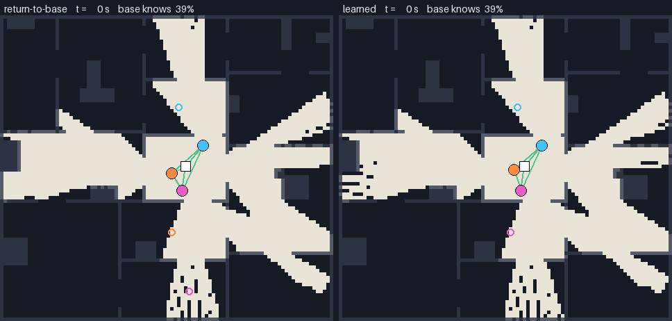
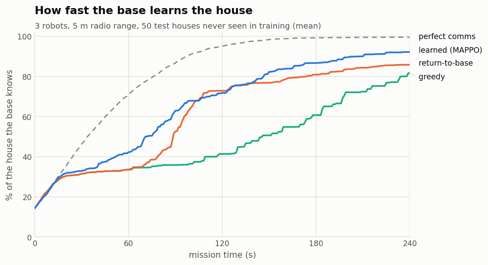
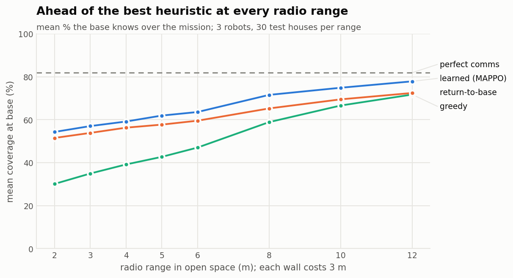
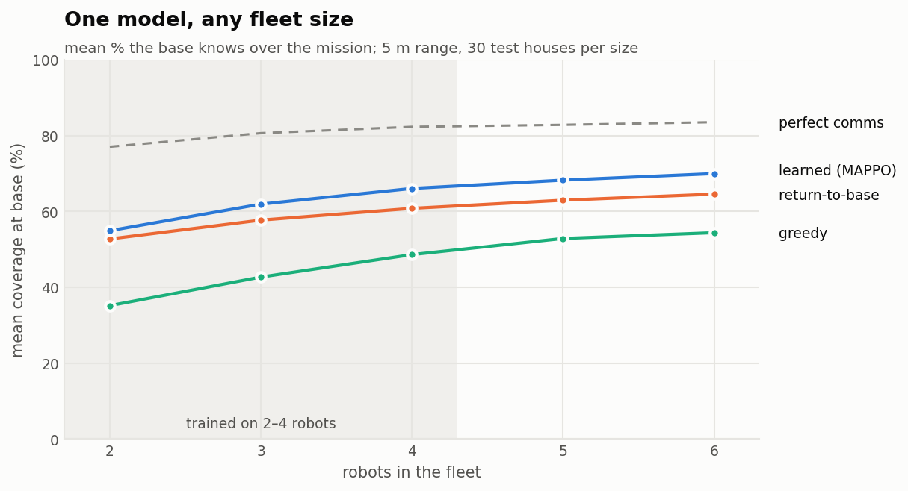
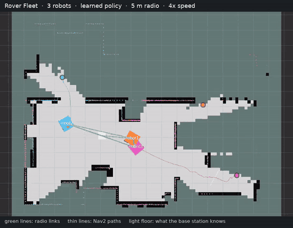
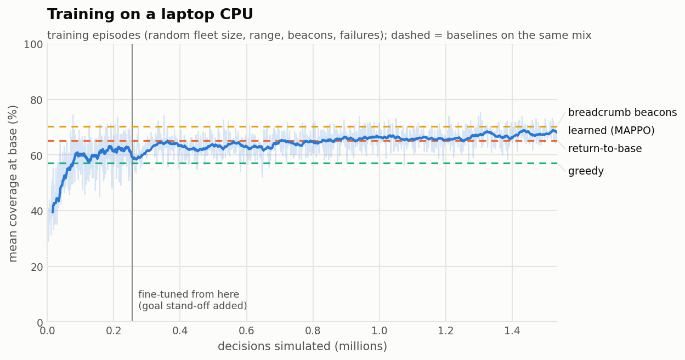
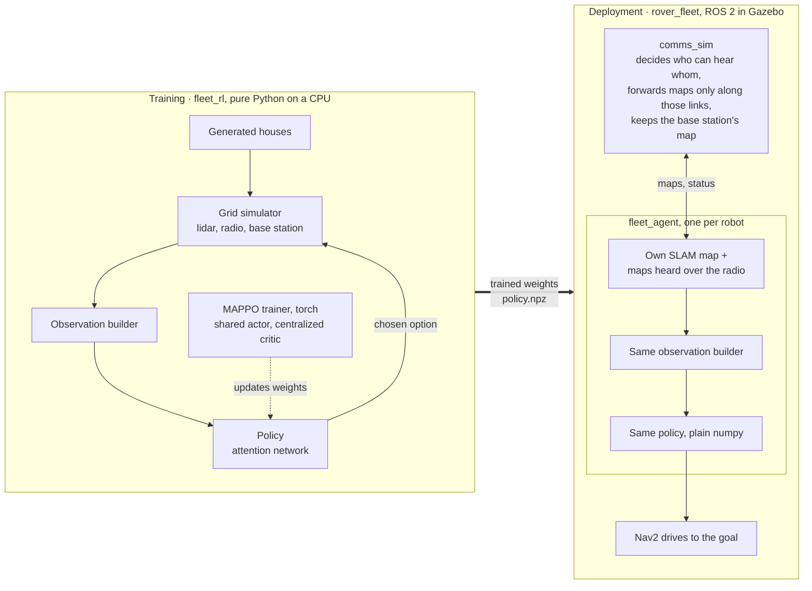

# Rover Fleet

**Multi-robot exploration over a short-range radio. A learned policy decides, every few seconds, whether each robot explores, comes back to report, or stays put as a relay.**

<p align="center">
  
  <br><sub>A typical test house (the one whose difference is closest to the average), same start. Light floor is what the operator at the base knows; tinted floor is what a robot has seen but not yet reported; green lines are radio links. Averaged over the mission, the base knows 86% with return-to-base and 91% with the learned policy.</sub>
</p>

Three rovers map a house they have never seen. An operator waits at the base station. The radio only reaches a few meters and every wall costs 3 m of range, so whatever a robot sees out of range is unknown to the operator until it gets reported. **The score is how much of the house the base knows, averaged over the 4-minute mission**, so the fleet has to trade exploring against reporting back.

- **Learned coordination, classical control.** A multi-agent PPO policy picks *where* each robot goes; Nav2 decides *how* to get there; a lidar safety gate has the final word on every velocity command.
- **Beats the best tuned heuristic** on houses it never saw (+4.7 points of base coverage, 90% coverage 51 s sooner), at every radio range, and on fleet sizes it never trained on.
- **Trained on a laptop CPU** in about two hours, on a grid simulator written for this project (about 240x real time per core).
- **Runs on a ROS 2 Jazzy fleet in Gazebo**: each robot has its own SLAM and Nav2 stack, and a radio emulator forwards data only between robots that could actually hear each other.
- **Replays in the browser**: `docs/demo/index.html` (serve `docs/` with GitHub Pages, or open the file locally) plays every strategy on the same house, side by side.

## Results

Every number below comes from `fleet_rl.evaluate` on houses the policy never trained on (test seeds 1,000,000+; training used seeds below 100,000). Every strategy plays the same houses with the same seeds, so differences are measured house by house. The return-to-base heuristic's period was tuned on a separate set of houses (45 s won). The shipped model is the checkpoint that scored best on validation houses. Regenerate everything with `fleet_rl/make_results.sh`.

<picture>
  <source media="(prefers-color-scheme: dark)" srcset="docs/img/coverage_over_time_dark.png">
  
</picture>

**3 robots, 5 m radio, 50 test houses:**

| Strategy | Mean coverage at base | At the 240 s deadline | Time to 90% (median) |
|---|---|---|---|
| **Learned (MAPPO)** | **65.6%** ± 3.7 | **92.2%** | **151 s** |
| Return-to-base (tuned) | 60.9% ± 3.7 | 85.9% | 202 s |
| Greedy | 47.2% ± 5.6 | 81.7% | 195 s |
| Perfect comms (reference) | 81.9% ± 1.7 | 99.6% | 88 s |

The learned policy keeps the operator better informed for the whole mission: **+4.7 ± 1.4 points** over the best heuristic (paired, 95% CI), and the base knows 90% of the house **51 s sooner**.

<picture>
  <source media="(prefers-color-scheme: dark)" srcset="docs/img/comm_range_dark.png">
  
</picture>

<picture>
  <source media="(prefers-color-scheme: dark)" srcset="docs/img/fleet_size_dark.png">
  
</picture>

| Setting | Learned | Best baseline | Difference (paired, 95% CI) |
|---|---|---|---|
| 3 robots, 5 m radio (main) | 65.6% | 60.9% (return-to-base) | +4.7 ± 1.4 pts |
| Radio range 2 m | 54.3% | 51.5% (return-to-base) | +2.8 ± 1.9 pts |
| Radio range 3 m | 57.0% | 53.9% (return-to-base) | +3.2 ± 2.0 pts |
| Radio range 8 m | 71.6% | 65.3% (return-to-base) | +6.3 ± 2.1 pts |
| Radio range 12 m | 77.9% | 72.5% (return-to-base) | +5.4 ± 2.8 pts |
| 2 robots | 54.9% | 52.8% (return-to-base) | +2.2 ± 1.9 pts |
| 5 robots (never trained on) | 68.3% | 63.0% (return-to-base) | +5.3 ± 1.4 pts |
| 6 robots (never trained on) | 70.0% | 64.6% (return-to-base) | +5.4 ± 1.5 pts |
| One robot fails mid-mission | 64.4% | 59.7% (return-to-base) | +4.7 ± 1.3 pts |
| 2 relay beacons each | 68.2% | 67.9% (breadcrumb beacons) | +0.3 ± 1.9 pts |
| Random settings, like training | 70.6% | 70.4% (breadcrumb beacons) | +0.2 ± 1.3 pts |
| Gazebo house, in the grid sim | 96.0% | 95.4% (return-to-base) | +0.7 ± 0.3 pts |

Where it doesn't win: when robots carry relay beacons, the learned policy only ties a simple hand-written rule ("drop a beacon just before you lose signal"). The random-settings row ties for the same reason: two thirds of those episodes have beacons. And the 16 × 12 m Gazebo house is small enough that every strategy maps about 95% of it.

**In Gazebo**, three 3-robot runs with the shipped policy (a demonstration rather than a benchmark; logs in `docs/results/gazebo/`): the base knew 93–94% of the house at the end and 87–88% on average over the mission. Each robot stayed localized within 3 cm (measured on an earlier run).

<p align="center"></p>
<p align="center"><sub>Run 1 in RViz, 8x speed: the house is mapped and the robots parked at the base well before the 240 s mission ends. Video at 4x: <a href="docs/video/fleet_rviz.mp4">docs/video/fleet_rviz.mp4</a>.</sub></p>

**Training** took about 2.2 hours of laptop CPU in two stages: 400 updates from scratch, then 1,000 updates resumed from that checkpoint after a small change to what "go to a teammate" means (stop 1.5 m short). The curve shows training episodes, where the policy samples its actions; played deterministically on the same mix it scores 70.6%.

<picture>
  <source media="(prefers-color-scheme: dark)" srcset="docs/img/learning_curve_dark.png">
  
</picture>

## How it works



**The radio.** Two nodes (robots, the base, dropped beacons) can talk if `distance + 3 m × walls crossed ≤ range`. Links chain, so a robot can report through a teammate. Robots in one connected group share maps instantly.

**What the policy decides.** Every 3 s each robot picks one option: one of up to 8 frontiers (edges of the known map), go toward a teammate, return to base, stay here as a relay, or drop a relay beacon. Each option is described by 15 numbers (path length, frontier size, radio margin there, whether a higher-priority teammate is already heading there, ...). An attention layer lets every option see the others and the robot's own state, then each option gets a score. Scoring a list means one small network (~50k parameters) works for any number of frontiers and robots.

**Training.** MAPPO: PPO with one actor shared by every robot and a critic that sees the true global state during training only. Every episode draws a random house, 2–4 robots, a 3–12 m radio range, 0–2 beacons each, robot speeds, and sometimes a robot failure, so one model covers every setting. The reward is shared: area newly known at the base, plus a small bonus for area newly discovered by anyone.

**Deployment.** `fleet.launch.py` starts one Gazebo world and N copies of the [single-robot stack](docs/SINGLE_ROBOT.md) (SLAM, Nav2, twist_mux, the lidar safety gate) in namespaces `robot1..N` on one shared TF tree. Each robot's `fleet_agent` resamples its SLAM map onto the same 0.2 m grid the policy trained on, builds the same observation, and runs the trained policy in plain numpy (no PyTorch on the robot side). Getting there took a few real multi-robot fixes, each one in the [decision log](docs/DESIGN.md#decision-log): fleet robots carry a slim mast so their lidars can see each other (the rover's body sits below the lidar plane) and share positions over the radio for Nav2's local costmap; goals near teammates stop short; places a robot has stood count as floor in everyone's map; and Nav2 recovers without spinning in place, which is what a skid-steer's odometry handles worst.

Full parameter tables, goals and the decision log: [docs/DESIGN.md](docs/DESIGN.md).

## Try it

Everything runs on ROS 2 Jazzy (Ubuntu 24.04) with Gazebo Harmonic. Build from the workspace root:

```bash
sudo apt install ros-jazzy-navigation2 ros-jazzy-nav2-bringup ros-jazzy-slam-toolbox ros-jazzy-twist-mux ros-jazzy-ros-gz ros-jazzy-foxglove-bridge ros-jazzy-topic-tools ros-jazzy-joint-state-publisher
colcon build --symlink-install
source install/setup.bash
```

### The Gazebo fleet

```bash
ros2 launch rover_bringup fleet.launch.py                                   # 3 robots, learned policy
ros2 launch rover_bringup fleet.launch.py policy:=greedy robots:=2          # a baseline, 2 robots
ros2 launch rover_bringup fleet.launch.py comm_range:=3.0 beacons:=2        # shorter radio, relay beacons
ros2 launch rover_bringup fleet.launch.py gui:=false foxglove:=true         # headless, view in Foxglove
ros2 launch rover_bringup fleet.launch.py odometry:=wheels                  # realistic wheel odometry (drifts)
```

Robots spawn 4 s apart and only appear in RViz once their SLAM is publishing, so give it about 30 s. If you still see only one robot, a Gazebo server from an earlier run may still be alive and the robots are spawning into two different worlds: check with `pgrep -fa "gz sim server"`, stop it, and launch again.

A 3-robot fleet is a lot for one machine (Gazebo plus 3 × SLAM and Nav2): close other heavy programs, and if another ROS system is running, give the fleet its own `ROS_DOMAIN_ID`.

Robots start exploring as soon as their SLAM and Nav2 are up, and drive home when `mission_seconds` (240) runs out. Watch `/fleet/coverage` for how much the base knows. View the fleet with `rviz:=true` or with Foxglove (`foxglove:=true`, connect to `ws://localhost:8765`, import `rover_bringup/foxglove/fleet.json`). To save a run as a GIF:

```bash
ros2 run rover_fleet record_run --ros-args -p use_sim_time:=true -p duration:=240.0 -p out:=$HOME/fleet_run
```

To film the run in RViz instead (off-screen, only needs Docker), launch with `gui:=false` and start this right after:

```bash
tools/rviz_recorder/record_fleet.sh 510 rviz_out
```

### The grid simulator, benchmark and training (no ROS needed)

Training needs PyTorch (CPU build); evaluation and the robots don't.

```bash
/usr/bin/python3 -m venv --system-site-packages ~/venvs/fleet
~/venvs/fleet/bin/pip install torch --index-url https://download.pytorch.org/whl/cpu
cd fleet_rl
~/venvs/fleet/bin/python -m pytest test                     # unit tests
python3 -m fleet_rl.evaluate                                 # benchmark -> docs/results/results.json
python3 -m fleet_rl.charts                                   # charts -> docs/img/
~/venvs/fleet/bin/python -m fleet_rl.train --name mine       # train (about 2 h on 8 cores)
```

### Docker

```bash
docker build -t rover-fleet .
docker run --rm rover-fleet bash -lc "cd /ws && colcon test && colcon test-result --verbose"
```

CI builds this image and runs the lint, unit tests and a launch-file check on every push.

## Repository layout

| Package | What's in it |
|---|---|
| `fleet_rl` | Pure Python: grid simulator, radio model, observation builder, baselines, MAPPO training, numpy policy, benchmark, charts, replays. The trained model ships in `fleet_rl/fleet_rl/models/policy.npz`. |
| `rover_fleet` | ROS 2 nodes: `comms_sim` (radio + base station), `fleet_agent` (one robot's decisions), `record_run` (GIF of a run). |
| `rover_bringup` | Launch files and configs: `fleet.launch.py`, `rover.launch.py` (single robot), Nav2, SLAM, Gazebo world, RViz and Foxglove layouts. |
| `rover_autonomy` | C++: the single-robot mission FSM with frontier exploration, and the lidar safety gate every robot uses. |
| `rover_description` | The robot model; `ns:=robotN` prefixes its Gazebo topics and frames for the fleet. |
| `tools/rviz_recorder` | Films a fleet run in RViz off-screen (Docker, no window or GPU) and makes the captioned video and GIF above. |

## Limitations

- **The Gazebo fleet uses exact odometry.** This rover's skid-steer wheel odometry drifted by 90–170° within a minute in controlled tests, and no SLAM recovers from that. SLAM still builds every robot's map from its own lidar; `odometry:=wheels` brings the realistic version back.
- **The radio model is simple.** Range minus 3 m per wall along a straight line; robots in a connected group share everything instantly (no bandwidth, latency or packet loss).
- **Grid-sim robots don't collide.** Gazebo handles collisions (masts, shared positions, Nav2), but the policy never learned to avoid crowding.
- **Beacons:** the learned policy ties, not beats, the breadcrumb heuristic.
- **Simulation only**, one training run plus one fine-tuning stage, no hyperparameter sweep.

Next steps I'd take: bandwidth-limited map sharing, learned prediction of what lies behind a frontier, IMU-fused odometry so the fleet can drop exact odometry, and two or three physical rovers.
