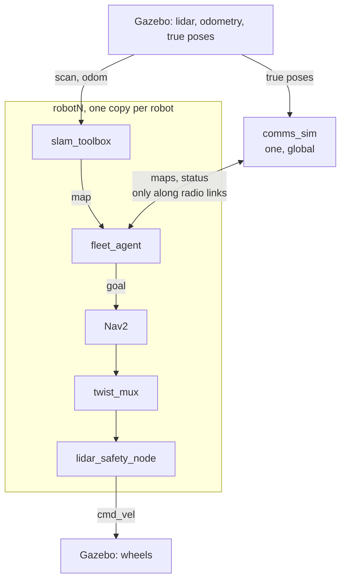

# Fleet exploration under limited communication — design

This is the contract for the fleet project: what it is, what it is not, every
parameter in one place, and how each milestone is judged "done". Code
constants live in `fleet_rl/fleet_rl/config.py` and must match the tables
here.

## The problem in one paragraph

A team of rovers explores an unknown house. An operator waits at a **base
station** at the entrance. Robots can only exchange data over a short-range
radio that walls weaken, so a robot that explores out of range knows things
the base doesn't. **The score is how much of the house the base knows**, so the
fleet has to balance exploring against reporting back: return to base, meet a
teammate, stay put as a relay, or drop a relay beacon. A learned policy picks
*where* each robot goes; Nav2 decides *how* to get there; the lidar safety gate
has the final word on every velocity command.

## Goals

| # | Goal |
|---|------|
| G1 | A ROS-free grid simulator that is fast on a CPU, with procedurally generated houses and the Gazebo house loaded from its SDF file. |
| G2 | A limited-communication model: range + wall penalty, multi-hop links, a base station, relay beacons. |
| G3 | Hand-written baselines: greedy (the single-robot FSM's frontier rule), greedy + return-to-base, greedy + breadcrumb beacons, and a perfect-comms reference. |
| G4 | A learned policy (MAPPO: one shared actor, centralized critic) trained on CPU in about two hours, evaluated honestly against the baselines on houses it never saw. |
| G5 | The same decision code running in Gazebo: 3 robots, each with its own SLAM + Nav2 + safety gate, with all robot-to-robot data passing through a comms emulator. |
| G6 | Visuals: episode GIFs, benchmark charts, a browser replay demo, a Foxglove fleet layout. |
| G7 | Engineering: tests, CI, Docker, and docs. |

## Non-goals (deliberately out of scope)

- **Real hardware.** Everything, the single robot included, runs in simulation.
- **Learning velocity control.** Nav2 drives. The policy only picks goals.
- **Bandwidth, latency, packet loss.** Robots in one connected group share everything instantly.
- **Robot-robot collisions in the grid sim.** Gazebo has them (lidar + Nav2 + safety gate handle them).
- **Unknown starting poses.** Spawn poses are known, so maps merge by a fixed transform.
- **GPU, large CNNs, map prediction.**

## Architecture

`fleet_rl` is plain Python with no ROS; `rover_fleet` holds the ROS 2 nodes. Gazebo runs the same observation and decision code as the benchmark, imported from `fleet_rl`.

| Module (`fleet_rl/`) | Job | Gazebo uses it |
|---|---|---|
| `config.py` | simulator, house and training-randomization settings | yes |
| `houses.py` | generated houses, SDF loader, Gazebo spawn poses | SDF loader, spawns |
| `grid.py` | lidar raycast, line of sight, Dijkstra | yes (via observations) |
| `frontiers.py` | frontier detection | yes (via observations) |
| `comms.py` | radio links, connected groups, map merge | yes (`comms_sim`, `fleet_agent`) |
| `sim.py` | the training world | no |
| `observations.py` | options + features | yes |
| `baselines.py`, `policy.py` | decide | yes |
| `model.py`, `train.py` | MAPPO (torch, training only) | no |
| `evaluate.py`, `select_model.py`, `report.py`, `charts.py`, `render.py`, `media.py`, `replays.py` | benchmark, model selection, charts, GIFs, replays | `render.py` (`record_run`) |

How the nodes connect in Gazebo:

Per robot in Gazebo (namespace `robotN`, frames `robotN/...`, one shared `/tf` tree):

## Parameters

### World and robot (grid sim)

| Parameter | Value | Why |
|---|---|---|
| Cell size | 0.2 m | 4x fewer cells than 0.1 m, so CPU training is fast. A doorway is still 8 cells wide. |
| Generated house | 18–28 m × 14–22 m | Calibrated (M2): in 12–20 m houses three robots map 90% in 40 s even with perfect comms, so there is nothing to coordinate. The 16 × 12 m Gazebo house is a held-out test. |
| Rooms | split until a side would be under 3 m | Room-sized spaces. |
| Walls / doors | 0.2 m thick / 1.6 m wide | The Gazebo house has 1.5–2 m doorways. |
| Extra (loop) doors | 30% chance per adjacent room pair after the tree is built | Gives loops, not just a tree. |
| Furniture | 0–2 boxes per room, never blocking a door | Clutter for frontiers and line of sight. |
| Robot planning radius | 0.45 m | The rover is 0.80 × 0.76 m. |
| Robot speed | 0.4 m/s, × U(0.75, 1.0) per robot in training | Nav2's max is 0.8 m/s; turning and slowdowns halve it. |
| Lidar | 360°, 180 rays, 10 m | Matches the Gazebo lidar. Calibration showed 6 m vs 10 m barely matters: rooms are small. |
| Tick | 0.5 s | Simulation step. |
| Decision period | 3 s (6 ticks) | The robot moves about 1.2 m per decision. |
| Episode length | 240 s (80 decisions) | Calibrated (M2): perfect comms maps 90% in about 90 s, limited-comms baselines are still well short of that at the deadline. |

### Communication

| Parameter | Value | Why |
|---|---|---|
| Link rule | `distance + wall_penalty × walls_crossed ≤ comm_range` | Like a path-loss model: distance and each wall weaken the signal. |
| Wall penalty | 3 m per wall | One wall costs about half a room of range. |
| Comm range | trained on U(3, 12) m; default 5 m | At 5 m greedy keeps the base 0.58 informed on average vs 0.85 with perfect comms (calibration, 24 houses). Evaluation sweeps 2–12 m plus infinite. |
| Multi-hop | yes, via connected groups | Enables relay chains. |
| Sharing | maps + teammate status + known beacons merge within a group every tick | No bandwidth model (non-goal). |
| Base station | fixed at the spawn point; robots start within 1.5 m of it | |
| Beacons | 0–2 per robot in training (random); evaluated at 0 and 2 | A dropped beacon is a fixed relay node. |
| Robot dropout | 20% of training episodes lose one robot at a random time | Robustness; evaluated as its own condition. |

### Policy

| Parameter | Value |
|---|---|
| Options per robot | up to 8 frontiers + up to 5 teammates + base + stay + drop beacon = 16 slots (invalid ones masked) |
| Teammate / base goals | stop 1.5 m / 1 m short on the path (close enough for the radio; robots told to drive to the same spot collide in Gazebo) |
| Coordination prior | fixed priority: a robot's "claimed" feature only counts goals of lower-id teammates, so conflicts resolve one way instead of both robots switching |
| Fleet size | trained on 2–4 robots; tested on 2–6 (max 6) |
| Actor | per-option MLP → 64-d, plus a "self" token; 1 attention layer (4 heads); a score per option; softmax over valid options |
| Critic (training only) | global state: per-robot features pooled with mean + max, plus true coverage and time left |
| Inference on the ROS side | plain numpy (no torch), checked against torch by a test |

### Reward and training (MAPPO)

| Parameter | Value |
|---|---|
| Reward per decision (shared by the team) | (m² newly known at base + 0.25 × m² newly known by any robot) / 10 |
| Parallel environments | 8 (processes) |
| Decisions per update | stage 1: 80 per environment (8 episodes); stage 2: 160 (16 episodes) |
| γ / GAE λ / clip | 0.99 / 0.95 / 0.2 |
| Learning rate | 3e-4, linear decay to 0 |
| Entropy / value coefficients | 0.01 / 0.5 |
| Epochs / minibatches per update | 4 / 4 |
| Gradient clip | 0.5 |
| Schedule | stage 1: 400 updates from scratch; stage 2: 1,000 updates resumed from stage 1 after the goal stand-off was added (see decision log) |
| Budget | about 2 h CPU |

### Evaluation

| Parameter | Value |
|---|---|
| Training houses | seeds 0 – 99,999 |
| Test houses | seeds 1,000,000+ (never trained on), 50 per condition |
| Metrics | base coverage at the end; mean base coverage over the episode (area under the curve); time to 90% |
| Coverage | % of the free space reachable from the base that the base knows |

### Gazebo fleet

| Parameter | Value |
|---|---|
| Robots | 3, namespaces `robot1..3`, spawn poses checked against the world grid |
| Base station | the house's living-room spawn area |
| comms_sim rate | 2 Hz |
| Agent decision period | 3 s (same as training) |
| Seeing teammates | fleet robots carry a 0.12 m mast that crosses the lidar plane (their own scan is 340°, leaving out the mast); agents also publish the teammates they hear from as a point cloud for Nav2's local costmap |
| Trail clearing | cells within 0.5 m of anywhere a robot has stood are free in the agent's belief (SLAM maps a teammate's mast like any obstacle) |
| Nav2 behavior tree | the stock replanning tree with 2 retries instead of 6, no spin recovery, and back-up as the second recovery (`rover_bringup/behavior_trees/fleet_navigate_to_pose.xml`) |
| Back-up recovery | 0.3 m at 0.15 m/s, no costmap look-ahead (`simulate_ahead_time` 0, fleet only) |
| Stuck watchdog | give up on a goal after moving under 0.3 m in 15 s (`rover_fleet/progress.py`) |
| Going to the base | each robot parks at its own spawn spot (1.3 m apart, in radio contact), not the policy's shared point 1 m from the base |
| Odometry | Gazebo's exact pose (`odometry:=truth`, default); `odometry:=wheels` keeps the skid-steer wheel odometry. SLAM builds every map either way |
| SLAM scan rate | a new scan every 0.2 m / 0.2 rad (single robot: 0.5) |
| Sim clock | republished at 100 Hz (`clock_hz`) instead of Gazebo's 1 kHz |
| Wheel joint states | ROS `joint_state_publisher` at 10 Hz; Gazebo's plugin stays loaded but unbridged (the DiffDrive plugin needs it) |
| Map exchange | own SLAM map, downsampled to the 0.2 m world grid, 1 Hz |

## Milestones and "done when"

| | Milestone | Done when |
|---|---|---|
| M1 | Grid sim core | Unit tests pass; a 3-robot, 300 s episode runs in a few seconds on one core; a rendered GIF looks right. |
| M2 | Baselines + benchmark + calibration | Coverage curves for every baseline on 50 test houses; default comm range and episode length fixed so the best baseline does not saturate. |
| M3 | MAPPO | numpy/torch equivalence test passes; training improves steadily; learned vs. best baseline reported on test houses, honestly either way. |
| M4 | Gazebo fleet | `ros2 launch rover_bringup fleet.launch.py` brings up 3 robots (GUI and headless); robots only learn about each other through comms_sim; base coverage grows with both greedy and learned policies; `rover.launch.py` still works unchanged. |
| M5 | Visuals | Charts, GIFs, browser replay demo, Foxglove fleet layout. |
| M6 | Engineering | Tests + CI reproduced locally in Docker; Dockerfile; README and this doc. |

## Decision log

| Decision | Alternatives | Why |
|---|---|---|
| RL picks goals (macro-actions), Nav2 drives | RL outputs velocities | About 100 decisions per episode instead of 50,000: trainable on a CPU. The policy can't drive into a wall: the safety gate is untouched. |
| Score options with attention (pointer-style) | Fixed-size action vector, CNN on the map | Works for any number of frontiers and robots; tiny, so fast on a CPU. |
| Randomize fleet size, comm range, beacons and houses | Staged curriculum | Simpler, and one model covers every setting. |
| numpy inference in ROS nodes | ONNX Runtime, torch | No ML dependency on the robot side; a test proves it matches torch. |
| Status as JSON in `std_msgs/String` | Custom message package | Avoids a CMake interface package; maps still use `nav_msgs/OccupancyGrid`. |
| Frame prefixes + one `/tf` tree | Separate `/robotN/tf` trees | Foxglove/RViz see the whole fleet; any node can transform between robots. |
| comms_sim uses Gazebo ground truth | Robots' own pose estimates | Radio physics is part of the simulated world, like Gazebo physics. Robots themselves only use their own estimates. |
| Instant merge inside a connected group | Bandwidth/latency model | Keeps the model explainable; the explore-vs-report trade-off already exists without it. |
| Bigger generated houses (18–28 m) | 12–20 m | Calibration: in small houses perfect comms and limited comms score almost the same, so there is nothing to coordinate. |
| Teammate/base goals stop short | Exact positions | First 3-robot Gazebo run: robots drove into each other, Nav2 spun them in place over and over, and SLAM lost its heading by up to 200°. The change lives in the shared observation code, so training and Gazebo agree. |
| Resume training after the stand-off change | Retrain from scratch | The change moves two option types by 1–1.5 m; a from-scratch rerun was tracking below the first run at the same point (seed variance), so stage 2 resumes from stage 1's checkpoint with a larger batch. |
| Trails mark floor as free (Gazebo agent) | Filter robots out of scans | Walls don't move, robots do: anywhere a robot stood is floor. Fixed the base looking unreachable after robots mapped each other at the start. |
| No spin recovery in the fleet's Nav2 tree | Stock tree | Spinning in place is where skid-steer odometry is worst, and failed goals are cheap because the policy re-decides every 3 s. |
| Back-up second, without the look-ahead check | Stock order (clear, wait, back up) | With 2 retries the stock order never reached back-up, and when it did run, the costmap check refused it: a robot wedged against a door post or a teammate already overlaps the inflated obstacle. Robots stayed jammed for the rest of the mission (2 of 5 test runs). It reverses only 0.3 m, slowly, into space it just drove through. |
| Each robot parks at its own spot at the base | The policy's shared stop-short point | Grid-sim robots pass through each other, so every robot aimed for the same point and in Gazebo they pinned each other against the dining table. Spawn spots are known to fit and are in radio contact, so nothing the policy cares about changes. |
| Mast + shared positions so robots see each other | Rely on lidar alone | The rover's body is below the lidar plane: teammates were invisible to Nav2 and the safety gate, robots collided, and SLAM lost its pose. The mast is fleet-only; the single robot's model is unchanged. |
| Teammate cloud in the local costmap only | Local and global | In the global costmap teammate marks outlived the robots (clearing scans are dropped when SLAM's transform lags) and walled robots in. |
| Ground-truth odometry in the Gazebo fleet | Skid-steer wheel odometry | Controlled single-robot runs showed wheel odometry drifting 90–170° within a minute; SLAM can't recover from that, and every merged map broke. This project is about coordination, not localization, so the fleet uses exact odometry (SLAM still maps from each robot's lidar); `odometry:=wheels` keeps the realistic version. |
| Throttle `/clock` to 100 Hz | Raw 1 kHz clock | ~45 sim-time nodes each woke for every physics step; the Python nodes spent most of their CPU on it and the machine hit load 28 with 3 robots. |
| Re-send a "succeeded" goal if the robot isn't within 1 m | Trust Nav2's result | Nav2's stateful goal checker can keep "already there" across a preempted goal and report success 1 m away. |
| Give up on a goal after moving under 0.3 m in 15 s (`rover_fleet/progress.py`) | Wait for Nav2 to abort | At the mouth of a slot the rover barely fits, Nav2 kept pushing forward and the safety gate kept blocking it: about a minute of twitching in place before Nav2 aborted. The grid sim has no such case, so this is deployment-only, like the arrival check. The next goal replaces the stuck one in Nav2 (no explicit cancel: cancelling right before sending a new goal cancelled the new one too). |
