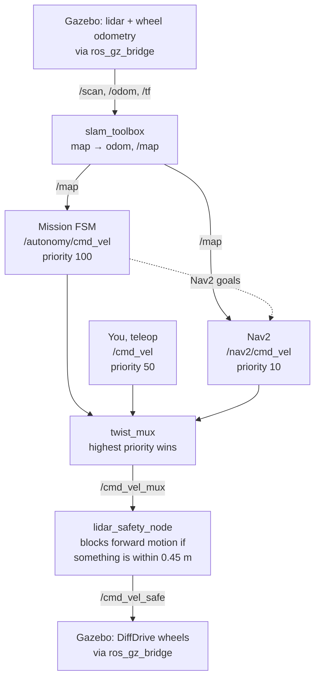

# Single-robot stack

The foundation the fleet is built on (see the [main README](../README.md)).
A 4-wheel differential-drive rover with a 2D lidar, on ROS 2 Jazzy, in
Gazebo Harmonic: SLAM mapping, Nav2 navigation and an autonomous mission FSM.

In the fleet, every robot runs this same stack in its own namespace
(`robot1/...`), with its config files rewritten per robot; nothing here
changes for the single robot.

## Packages

| Package | What's in it |
|---|---|
| `rover_description` | The robot model (`rover.urdf.xacro`) and its Gazebo drive, joint-state and lidar plugins (`gazebo.xacro`). |
| `rover_bringup` | `rover.launch.py` (the single-robot entry point; `fleet.launch.py` for the fleet) + every config: Gazebo world/bridge, SLAM, Nav2, twist_mux, RViz. No code. |
| `rover_autonomy` | C++ nodes: the mission FSM (with frontier exploration) and the lidar safety gate. |

## Architecture



Everything above the drive only sees `/odom`, `/tf`, `/scan` and publishes
Twist, so SLAM, Nav2 and the FSM don't know they're in Gazebo. Every node
runs on Gazebo's clock (`use_sim_time`), set by the launch file.

**One safety gate.** `lidar_safety_node` is the only obstacle stop, and every
command passes through it. It zeroes forward motion when something is within
0.45 m of the lidar in a ±35° cone; reversing and turning always pass, so you
can back out. The FSM's AVOID_OBSTACLE state triggers earlier (0.6 m) as a
*behavior*, not as a safety stop.

**Lean Nav2.** `rover_bringup/launch/nav.launch.py` starts only the four Nav2
servers the default navigate-to-pose behavior tree uses: planner, controller,
recoveries (spin / back up / wait) and bt_navigator. Jazzy's stock
`navigation_launch.py` also starts docking, route, waypoint, smoother,
velocity-smoother and collision-monitor servers this robot doesn't use.

## Build

Always from the workspace root:
```bash
cd ~/ros2_ws
sudo apt install ros-jazzy-twist-mux ros-jazzy-navigation2 ros-jazzy-nav2-bringup ros-jazzy-slam-toolbox
colcon build --symlink-install
source install/setup.bash
```

A normal rebuild is just `colcon build --symlink-install` again — no need to
delete anything. With `--symlink-install`, edits to launch files, configs,
the URDF and the world take effect without rebuilding at all; only C++ changes
and *new* files need a build. Delete `build install log` only after moving or
renaming packages (see Troubleshooting). Never run `colcon build` from inside
`src/` — it creates a second, separate `build/install/log` there.

## Run in simulation

The world (`rover_bringup/worlds/rover_world.sdf`) is a 16 m × 12 m house:
a living room with a dining table (where the rover spawns), a kitchen with an
island, and two bedrooms, joined by 1.5–2 m doorways. The living room and
kitchen connect twice, so a loop through them gives SLAM a loop closure.
Every gap between furniture is either 1.5 m+ (passable) or under 0.6 m
(closed): the rover is 0.80 × 0.76 m, and in-between gaps are ones Nav2
attempts and the rover gets stuck in. (Avoid tables on thin legs: the 2D lidar only sees the
legs, so Nav2 tries to thread between them.)

```bash
ros2 launch rover_bringup rover.launch.py                                   # drive only
ros2 launch rover_bringup rover.launch.py slam:=true                        # + mapping
ros2 launch rover_bringup rover.launch.py slam:=true nav:=true              # + Nav2 (click "2D Goal Pose" in RViz)
ros2 launch rover_bringup rover.launch.py slam:=true nav:=true autonomy:=true  # + mission FSM
```
Drive in a second terminal (works alongside Nav2/FSM — see priorities above):
```bash
ros2 run teleop_twist_keyboard teleop_twist_keyboard
```

**Save the map** before you stop the launch — SLAM keeps it only in memory,
so it's gone once you Ctrl+C. In a second terminal:
```bash
mkdir -p ~/maps
ros2 run nav2_map_server map_saver_cli -f ~/maps/house --fmt png --ros-args -p use_sim_time:=true -p save_map_timeout:=10.0
```
That writes `~/maps/house.png` (white = free, black = walls, gray = unexplored)
and `~/maps/house.yaml` (scale and origin, which ROS needs to load it back).
Use a new name each time or it overwrites. (`--fmt png` because the default,
`.pgm`, won't open in most image viewers.)

**View a saved map:**
- As a picture: open `\\wsl$\Ubuntu\home\<you>\maps\house.png` in Windows File
  Explorer, or `explorer.exe ~/maps` from the WSL terminal.
- In RViz, nothing else running: `ros2 launch rover_bringup view_map.launch.py map:=~/maps/house.yaml`

## View in Foxglove

```bash
ros2 launch rover_bringup rover.launch.py slam:=true nav:=true autonomy:=true foxglove:=true
```
1. In Foxglove (desktop app or app.foxglove.dev): **Open connection → Foxglove
   WebSocket → `ws://localhost:8765`**. From another machine, use this computer's IP.
2. **Layouts → Import from file →** `rover_bringup/foxglove/rover.json`.

The layout has:
- a 3D view in the `map` frame (robot, lidar, map, Nav2 plans; publish a pose
  to send a Nav2 goal). Without `slam:=true` there's no `map` frame — switch
  the 3D panel's display frame to `odom`.
- an FSM state indicator
- an E-STOP button
- mission buttons (explore, return home, stop, clear e-stop)
- teleop arrows (publishes `/cmd_vel`, so it goes through twist_mux like the keyboard)
- a plot of commanded vs actual speed

## Autonomy FSM

`rover_autonomy/src/autonomous_decision_maker.cpp`, five states:

- **IDLE** — waiting for a mission.
- **EXPLORE** — frontier exploration. Reads the SLAM map, finds
  *frontiers* (edges where known free space meets unknown), and sends Nav2 to
  the best one: `cost = distance_weight × distance − size_weight × length`,
  so near, long frontiers (like a doorway into an unseen room) win. It moves
  on as soon as the target has been seen, instead of driving all the way
  there. Goal points keep 0.6 m from obstacles so the rover can always turn
  around there. It ignores frontiers that only open onto a small unknown pocket
  (under 4 m²): those are shadows behind or under furniture that a 2D lidar
  can never see into, not rooms. Frontiers Nav2 can't reach, or that stay
  unexplored after arriving, get blacklisted. When none are left, or the map
  stops growing (under 1 m² new in 60 s — the leftovers are then spots the
  lidar can never see), it returns home by itself and goes IDLE.
- **AVOID_OBSTACLE** — cancels the Nav2 goal, backs up and turns toward the
  side with more room, then resumes whatever it interrupted.
- **RETURN_HOME** — navigates to the pose where `map→body_link` first
  became available; IDLE on arrival.
- **EMERGENCY_STOP** — from any state; publishes zero velocity at top
  priority and cancels Nav2. Only `clear_emergency` leaves it.

```bash
ros2 service call /autonomy/start_explore std_srvs/srv/Trigger
ros2 service call /autonomy/return_home std_srvs/srv/Trigger
ros2 service call /autonomy/stop std_srvs/srv/Trigger
ros2 topic pub /autonomy/emergency_stop std_msgs/msg/Bool "{data: true}" --once
ros2 service call /autonomy/clear_emergency std_srvs/srv/Trigger
ros2 topic echo /autonomy/state
```
Tuning lives in `rover_bringup/config/autonomy.yaml` (frontier weights and
filters, blacklist radius, per-frontier timeout, when to call exploration done). Other
defaults, in the code: `evaluation_rate_hz` 10, `obstacle_distance` 0.6 m,
`obstacle_frontal_angle_deg` 40, `avoid_backup_speed` -0.15 m/s,
`avoid_turn_speed` 0.6 rad/s, `avoid_min_duration` 2 s.

## Troubleshooting

Work down the ladder, stop at the first thing that looks wrong:
```bash
ros2 pkg prefix rover_bringup     # sourced and built?
ros2 node list                    # is it running?
ros2 topic hz /scan               # is data flowing?
ros2 run tf2_tools view_frames    # map → odom → body_link → lidar_link all connected?
```

- **`ros2 launch` says a file wasn't found but the package exists** — stale
  install after moving/renaming files:
  `rm -rf build install log && colcon build --symlink-install`.
- **Gazebo won't open / lidar all `inf` (WSL2)** — the world already forces
  the `ogre` renderer; if it still fails, `export LIBGL_ALWAYS_SOFTWARE=1`.
- **Robot won't move forward** — check `lidar_safety_node`'s log: something
  is within 0.45 m ahead. Reverse or turn away.
- **`map_saver_cli`: "Failed to spin map subscription"** — `slam:=true`
  isn't running, the robot hasn't moved ~0.5 m yet, or discovery took longer
  than the default 2 s wait (common on WSL; `-p save_map_timeout:=10.0`).
- **The map rotates when the rover turns** — odometry is misjudging turns
  and SLAM keeps correcting it. A 4-wheel skid-steer scrubs sideways when it
  turns, so it turns less than wheel speeds predict. The sim compensates with
  an effective track width (`skid_steer_track_factor` 1.32 in
  `rover_description/urdf/gazebo.xacro`, measured against Gazebo ground
  truth). RViz views from `map` when `slam:=true`, where the map stays fixed.
- **TF "extrapolation into the future/past"** — a node started outside
  `rover.launch.py` with the wrong `use_sim_time`.
